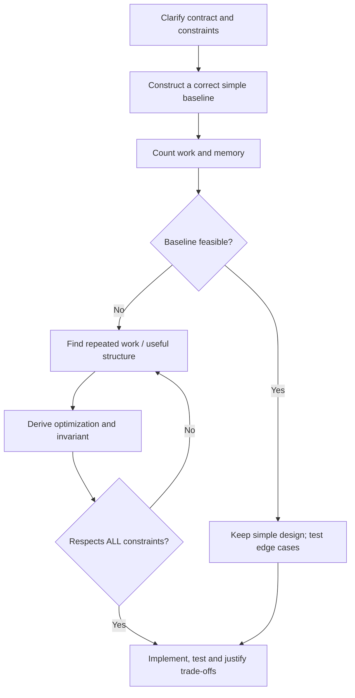
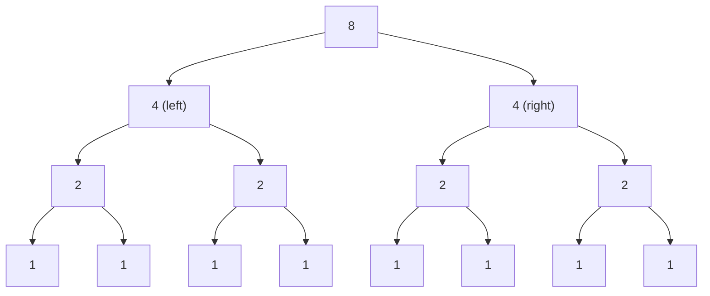

# DSA-0.01 — Algorithmic Thinking and Complexity

> **Phase:** 0 — Coding Interview Foundations  
> **Chapter status:** COMPLETED (learner-confirmed on 2026-11-01)  
> **Primary language:** Java  
> **Goal:** Derive a correct baseline, analyze complexity, choose an optimization that respects constraints, and defend the time/memory trade-offs in an interview.  
> **Prerequisites:** Basic Java loops, arrays, methods, and collections.  
> **Scope:** Interview-focused practical analysis, not complexity-theory research.

**Navigation:** [Canonical syllabus](../../../Curriculum/SYLLABUS.md#algorithmic-thinking-and-complexity-dsa-001) · [Chapter contents](../../../ProgressTracker/CONTENTS.md) · [Daily learning log](../../../ProgressTracker/DAILY_LOG.md)

This document is the **complete reference note**, intentionally more detailed than the short interactive lesson. Worked Java snippets are **teaching examples**, not claims of separately solved/committed practice problems.

## Learning objectives

After this chapter, you should be able to:

1. Extract constraints, input/output contracts, permitted mutation, and useful edge cases before choosing an algorithm.
2. Explain a correct straightforward baseline, derive the number of operations, and find a defensible improvement.
3. Use asymptotic notation correctly (O, Ω, Θ); distinguish best, worst, average/expected and amortized cost.
4. Analyze loops, nested loops, moving pointers, divide-by-two processes and recursive call trees.
5. Separate **time**, **peak auxiliary memory**, **output memory**, **input mutation** and real implementation overhead.
6. Recognize common Java traps (collections, copying, resizing, boxing, integer overflow and recursion stack).
7. Make a reasoned choice when a faster approach violates space, ordering or mutability constraints.

---

## 1. What algorithmic thinking actually means

Algorithmic thinking is **not** instantly remembering a LeetCode pattern. It is a repeatable decision process:



In interviews, ask only clarifications that change the solution:

| Question | Why it matters |
|---|---|
| What are `n` and numeric bounds? | Determines whether O(n²) or O(n log n) is feasible, and whether arithmetic overflows. |
| Is the input already sorted? | Often enables binary search or two pointers without a sort. |
| May I mutate/reorder the input? | Determines whether an in-place sorting approach is legal. |
| What is the auxiliary-memory limit? | May rule out a HashMap/HashSet or cloned array. |
| Are duplicates allowed? | Affects index-distinctness, pointer moves and hashing. |
| Return a boolean, indices, values, or all matching pairs? | Output requirements can change the algorithm and complexity. |
| Is the input a stream or a reusable array? | May constrain revisits, storage and one-pass logic. |
| Is worst-case latency important? | Average hash performance may not be a sufficient guarantee. |

**Baseline first:** A simple correct method gives you a yardstick, a test oracle and often a fallback when constraints are restrictive.

---

## 2. Running example — does a pair sum to a target?

**Original teaching problem (boolean variant):** Given an integer array and a target, return whether there exist **two different indices** whose values sum to the target. Unlike LeetCode's indices-returning variant, this exercise returns a boolean.

Example: `nums = [4, 8, 2, 7, 5]`, `target = 10`. The answer is `true` because 8 + 2 = 10.

We will compare three designs. The contract for the snippets below: `nums` must be non-null; if its length is smaller than 2, return `false`; any two different indices are allowed; values may repeat or be negative.

### 2.1 Baseline: enumerate distinct pairs

```java
static boolean hasPairBruteForce(int[] nums, int target) {
    Objects.requireNonNull(nums, "nums");

    for (int i = 0; i < nums.length; i++) {
        for (int j = i + 1; j < nums.length; j++) {
            if ((long) nums[i] + nums[j] == target) {
                return true;
            }
        }
    }
    return false;
}
```

Import `java.util.Objects` for the example. Casting before addition prevents 32-bit overflow from creating a false positive.

Why `j = i + 1`? This checks each unordered pair once, never combines an element with itself, and avoids checking both (i,j) and (j,i).

For `n` values, the maximum number of candidate pairs is:

```text
(n - 1) + (n - 2) + ... + 1 = n(n - 1)/2
```

Therefore **worst-case time Θ(n²)** and **auxiliary space Θ(1)**. The method may return after the very first comparison: **best-case time Θ(1)** for inputs of at least two elements where that first pair matches.

**Warning about a 100,000-element array:** it can require 4,999,950,000 comparisons. This is a scale warning, not a measured duration.

### 2.2 HashSet: remember previously seen values

Instead of repeatedly finding a complement, store values already scanned.

**Invariant:** Before examining current value `x`, `seen` contains exactly the values from earlier indices, never the current index. Thus a successful lookup proves that two distinct indices form a valid pair.

```java
import java.util.HashSet;
import java.util.Objects;
import java.util.Set;

static boolean hasPairHashSet(int[] nums, int target) {
    Objects.requireNonNull(nums, "nums");

    Set<Integer> seen = new HashSet<>();
    for (int x : nums) {
        long complement = (long) target - x;
        if (complement >= Integer.MIN_VALUE
                && complement <= Integer.MAX_VALUE
                && seen.contains((int) complement)) {
            return true;
        }
        seen.add(x);
    }
    return false;
}
```

Compute the complement as `long`: `target - x` can overflow `int`. Check representability before narrowing it back to `int`.

**Dry run for [4, 8, 2, 7, 5], target 10:**

| Current x | Needed | Seen before lookup | Found? | Action |
|---:|---:|---|---|---|
| 4 | 6 | {} | No | Add 4 |
| 8 | 2 | {4} | No | Add 8 |
| 2 | 8 | {4, 8} | **Yes** | Return true |

- **Expected / average hash-table time:** Θ(n), assuming well-behaved hashing and amortized constant-cost set operations.
- **Auxiliary space:** O(n) in the worst case (distinct values).
- A single hash operation is not contractually constant in all adversarial cases; don't present expected O(1) as an unconditional worst-case bound.
- In Java, `HashSet<Integer>` includes boxing, buckets and object overhead; 100,000 values can consume substantially more memory than 100,000 raw 4-byte integers.

Notice why **check before add** matters. If the target is twice `x`, inserting `x` first could incorrectly let an element pair with itself.

### 2.3 Sort + two pointers: pay for ordering, save lookup storage

If **input mutation is allowed**, sort the array, then maintain left/right pointers:

```text
Original: [4, 8, 2, 7, 5]
Sorted:   [2, 4, 5, 7, 8]

target = 10
left=2, right=8 -> sum=10 -> found
```

The pointer rule after sorting:

- If the sum is too small, move `left` right: any pair using the current smallest value with a value no larger than the current right cannot achieve a larger sum.
- If the sum is too large, move `right` left symmetrically.
- If equal, success.

```java
import java.util.Arrays;
import java.util.Objects;

static boolean hasPairAfterSortingInPlace(int[] nums, int target) {
    Objects.requireNonNull(nums, "nums");
    Arrays.sort(nums); // MUTATES input

    int left = 0;
    int right = nums.length - 1;
    while (left < right) {
        long sum = (long) nums[left] + nums[right];
        if (sum == target) return true;
        if (sum < target) left++;
        else right--;
    }
    return false;
}
```

The **pointer scan** is Θ(n) worst case, not Θ(n²), even though it has conditional moves: at every iteration, at least one pointer moves inward and no pointer reverses.

For the **whole algorithm**, primitive-array sorting typically dominates with O(n log n) time. **Do not promise universal worst-case guarantees for `Arrays.sort(int[])` without checking the specific JDK implementation/documentation.** Its implementation and stack/temporary-memory behavior are not the same API guarantee as a mathematically specified in-place heapsort.

If the original array must remain unchanged, `nums.clone()` costs O(n) additional space before sorting. Sorting a cloned array is not an O(1)-extra-space workaround.

### 2.4 Choosing under changed constraints

| Constraints | Appropriate approach | Why |
|---|---|---|
| Unsorted, many elements, memory available | HashSet | Expected linear time, extra memory accepted |
| Unsorted, O(1) auxiliary space, cannot mutate, time secondary | Brute force | Satisfies both hard restrictions |
| Unsorted, can reorder input, memory constrained | In-place sort + two pointers | Sacrifices sorting time, generally less extra memory than hashing; precise sort bound depends on implementation |
| Input already sorted | Two pointers directly | O(n) time, O(1) auxiliary space |
| Need original indices after sorting | Hash map or index-preserving sorted records | Plain in-place sort loses original index mapping |
| Return **all** valid pairs | Reassess output cost | Number of results can itself be Θ(n²) |

**Principal-level takeaway:** An asymptotically faster method is not automatically better if it breaks an API contract or hard memory budget.

---

## 3. Precise meaning of asymptotic notation

Big-O describes an **upper bound on growth** as input size grows, beyond a sufficiently large threshold; it does not directly measure seconds.

| Notation | Meaning | Practical interpretation |
|---|---|---|
| `O(g(n))` | Asymptotic upper bound | Work grows no faster than a constant multiple of `g(n)` eventually |
| `Ω(g(n))` | Asymptotic lower bound | Work grows at least as fast as a constant multiple of `g(n)` eventually |
| `Θ(g(n))` | Tight asymptotic bound | Both upper and lower bounds hold |

Example: `3n² + 7n + 20` is **Θ(n²)**, and therefore also O(n²). Technically it is also O(n³), but that bound is less informative.

**Important distinction:** The symbols O, Ω and Θ do **not** mean worst, best and average case respectively. A particular case's complexity can be described using any of those asymptotic bounds. E.g., brute-force pair search has best-case Θ(1) and worst-case Θ(n²).

### 3.1 Rules used in coding interviews

- **Sequential blocks add:** O(n) + O(n) = O(2n) = **O(n)**.
- **Nested independent full loops multiply:** n × n = **O(n²)**.
- **Different input dimensions stay different:** an n-element loop followed by an m-element loop is **O(n + m)**, not automatically O(n).
- **Dominant term wins:** O(n² + n log n + 100) = **O(n²)**.
- **Halving doubles logarithmic scale slowly:** repeated `n /= 2` is **O(log n)**.
- **Exponential branching can be enormous:** 2^n rises dramatically faster than n² or n log n.
- **Nested syntax does not prove quadratic complexity:** two pointers that each only advance at most n times can still be O(n).

For a loop where the inner bound depends on the outer index:

```java
for (int i = 0; i < n; i++) {
    for (int j = i + 1; j < n; j++) {
        consume(i, j); // assume O(1)
    }
}
```

Number of executions = `n(n-1)/2`, hence Θ(n²). The triangular sum explains **why**, rather than relying only on how many pairs of braces exist.

### 3.2 Common classes and growth intuition

| Class | Example | Key signal |
|---|---|---|
| O(1) | Indexed array read | Fixed amount of work |
| O(log n) | Binary search | Remaining search space halves |
| O(n) | Full scan | Each element visited constant times |
| O(n log n) | Efficient comparison sorting | Logarithmic levels with linear work at each |
| O(n²) | Compare every distinct pair | Work grows with pair count |
| O(2^n) | Binary choice at n positions | Each position doubles possible cases |
| O(n!) | Explore all permutations | Factorial number of orderings |

**Illustrative counts**, ignoring constant factors and implementation overhead:

| n | n | n log₂ n (approx.) | n² | 2^n |
|---:|---:|---:|---:|---:|
| 10 | 10 | 33 | 100 | 1,024 |
| 20 | 20 | 86 | 400 | 1,048,576 |
| 30 | 30 | 147 | 900 | 1,073,741,824 |

The table compares mathematical growth, **not benchmarked running time**. A O(n) hash-heavy solution can lose to O(n log n) cache-friendly code at realistic sizes because constants, allocations and data locality matter.

---

## 4. Best, worst, average, expected and amortized

Different words describe different questions.

### 4.1 Best vs worst case

For `hasPairBruteForce` with at least two values:

- **Best:** first compared pair matches → Θ(1).
- **Worst:** no pair matches (or only the last considered pair does) → Θ(n²).

Always specify **which case** the bound refers to.

### 4.2 Average / expected case

Average-case analysis requires a probability model over inputs. Expected hash-table performance also depends on assumptions about hashes, resizing and collision distribution. Interview explanations often state “expected O(n) using hashing,” rather than falsely claiming strict worst-case O(n).

### 4.3 Amortized analysis — not the same as average case

Amortized analysis bounds **total cost across a sequence of operations**, without assuming a probability distribution over the input. A few individually expensive operations can coexist with a small **average cost per operation over any sufficiently long sequence**.

Dynamic arrays are the standard example.

#### Capacity growth intuition

Imagine a dynamic array whose capacity doubles when full:

```text
capacity=1: [A]
append B -> allocate capacity 2; copy A
capacity=2: [A B]
append C -> allocate capacity 4; copy A,B
capacity=4: [A B C _]
append D -> [A B C D]
append E -> allocate capacity 8; copy A,B,C,D
```

A single resizing append copies Θ(k) elements if the old capacity is k, but the cumulative copied elements through n appends form a geometric series:

```text
1 + 2 + 4 + 8 + ... < 2n
```

Plus n writes for the new elements. Total cost is O(n) across n appends; **amortized append cost = O(1)**. A single append that triggers growth is still O(n) in the worst case.

**Java note:** `ArrayList` commonly grows geometrically, but its precise capacity growth rule is an implementation detail; the doubling example above is **illustrative** and not a promise of exact Java capacities.

### 4.4 Preallocation in Java

```java
List<Integer> a = new ArrayList<>();
List<Integer> b = new ArrayList<>(100_000);
```

When planning to add 100,000 items, `b` generally avoids repeated internal-array reallocations and copying; both cases remain **O(n) total insertion time**. Capacity is **not size**: immediately after construction, `b.size() == 0`, not 100,000.

Trade-off: reserving capacity may allocate more memory than needed if the estimate is too high. In common OpenJDK versions, a default empty `ArrayList` allocates its initial ten-element storage on the first append, not necessarily at constructor time; do not depend on that exact number as a portable specification.

For `ArrayList`, the common costs worth remembering:

| Operation | Typical cost | Caveat |
|---|---|---|
| `get(i)`, `set(i,x)`, `size()` | O(1) | Valid index assumption |
| `add(x)` at end | O(1) amortized | Individual growth append can be O(n) |
| `add(i,x)` in middle | O(n) | Elements shift |
| `remove(i)` in middle | O(n) | Elements shift |
| `contains(x)` | O(n) | Linear equality scan |
| `new ArrayList<>(n)` | Capacity reserve | Does not create n elements |

---

## 5. Recursive algorithm complexity

**Two separate questions:**

- **Time:** How many calls run in total, and how much work occurs inside each call?
- **Space:** How many call frames are active **simultaneously at maximum depth**? Sequentially executed branches do not occupy the whole recursion tree on the stack at once.

### 5.1 Single linear branch

```java
static void countDown(int n) {
    if (n <= 0) return;
    countDown(n - 1);
}
```

Recurrence: `T(n) = T(n-1) + O(1)` → **Θ(n) time**. Max active depth is Θ(n) → **Θ(n) auxiliary stack space**.

### 5.2 Single halving branch

```java
static void halve(int n) {
    if (n <= 1) return;
    halve(n / 2);
}
```

For n = 32: 32 → 16 → 8 → 4 → 2 → 1. So **Θ(log n) time** and **Θ(log n) stack space**.

### 5.3 Two halving branches — the key lesson example

```java
static void mystery(int n) {
    if (n <= 1) return;
    mystery(n / 2);
    mystery(n / 2);
}
```

For n = 8, the call tree is:



| Level | Number of calls | Input to each call |
|---:|---:|---:|
| 0 | 1 | 8 |
| 1 | 2 | 4 |
| 2 | 4 | 2 |
| 3 | 8 | 1 |
| **Total** | **15** | |

For n = 2^k, total calls = 1 + 2 + ... + 2^k = **2n − 1**.

- Recurrence: `T(n) = 2T(n/2) + O(1)` → **Θ(n) time**.
- Maximum active stack: 8 → 4 → 2 → 1, just k+1 calls → **Θ(log n) auxiliary space**.

**Why not O(n) stack?** The first recursive call returns before the second recursive call starts; both subtrees contribute to total work but are not simultaneously on the stack.

### 5.4 Similar-looking recursions with different costs

| Recurrence / work pattern | Time | Stack space | Why |
|---|---|---|---|
| `T(n)=T(n-1)+Θ(1)` | Θ(n) | Θ(n) | n sequential levels |
| `T(n)=T(n/2)+Θ(1)` | Θ(log n) | Θ(log n) | one halving branch |
| `T(n)=2T(n/2)+Θ(1)` | Θ(n) | Θ(log n) | n total nodes, logarithmic depth |
| `T(n)=2T(n/2)+Θ(n)` | Θ(n log n) | Θ(log n) if each frame O(1) | linear work at each of log levels |
| `T(n)=2T(n-1)+Θ(1)` | Θ(2^n) | Θ(n) | two branches with only decrement-by-one |

The listed stack bounds assume each frame stores only O(1) auxiliary data, and calls are executed sequentially. If a frame creates a new array/slice or retains a large buffer, include that memory separately.

**Practical warning:** Even with polynomial or linear time, deep Java recursion can trigger `StackOverflowError` because the JVM stack has a finite limit. Never treat O(log n) or O(n) as an actual byte budget without looking at depth and frame size.

---

## 6. Understand space complexity correctly

**Auxiliary space** counts extra working memory beyond the input; **total space** may also count input and output. State which definition you use.

Examples:

1. Iterating over an input array with two integer pointers: **O(1) auxiliary**.
2. Making `int[] copy = nums.clone()`: **O(n) auxiliary**.
3. Maintaining `HashSet<Integer>` of seen input values: **O(n) auxiliary**.
4. Recursing through depth n with constant-size frames: **O(n) stack space**.
5. Collecting all Θ(n²) matching pairs: output itself may need **Θ(n²)** space if materialized.

**Mutation is a separate contract:** an algorithm may be “in place” but still need a logarithmic recursion stack; another might use constant working memory but irrevocably modify the caller's array.

Use separate verbal labels in interviews:

- “Time: expected O(n)”
- “Auxiliary memory: O(n)”
- “Input preserved: yes”
- “Output space: O(1), because result is boolean”

---

## 7. Input-size budgets: feasibility before cleverness

Asymptotic complexity is a **screening tool**, not a wall-clock promise. Before choosing:

| n | Roughly n² work | Likely decision |
|---:|---:|---|
| 100 | 10,000 | Quadratic is often quite acceptable |
| 1,000 | 1,000,000 | May be feasible, depending on operation cost |
| 100,000 | 10,000,000,000 | Usually avoid quadratic when performance matters |
| 1,000,000 | 1,000,000,000,000 | Generally infeasible for ordinary interactive constraints |

Actual performance depends on CPU, JVM warmup/JIT, allocations, cache locality, I/O, and the work done in each iteration. A loop with `System.out.println` is not a comparable unit of work to an integer addition.

### 7.1 Practical sizing checklist

- Numeric values may fit in an `int`, but **intermediate sums or products might not**.
- Avoid `int` for `n(n-1)/2` when n is large; cast early: `((long) n * (n - 1)) / 2`.
- Hashing uses memory beyond raw data; estimate entries, buckets, boxing and overhead.
- When there are two input dimensions, report the right bound (e.g. O(n+m), O(nm)).
- If the function returns k items, at least Ω(k) time is needed to write them, and materialized output often needs Ω(k) memory.
- Strong worst-case guarantees may favor a theoretically slower but predictable design.

---

## 8. Correctness invariants and interview explanation

A complexity argument is insufficient unless the algorithm is **correct**.

For the HashSet approach, the invariant before each iteration is “`seen` contains previously visited values.” The complement check only succeeds using a distinct earlier index. After a failed check, adding the current value maintains the invariant for the next iteration.

For the sorted two-pointer approach, pointer movement is safe because ordering rules out entire sets of candidates: if the current sum is too small, using the smallest current value with an even smaller right-side value cannot fix it. Therefore incrementing the left pointer does not discard a possible solution. The symmetrical argument holds for a too-large sum.

In an interview, use this short structure:

1. **Contract:** “I need two distinct indices; duplicates allowed; do I preserve input?”
2. **Baseline:** “Try each unordered pair → O(n²), O(1) auxiliary.”
3. **Optimization:** “Maintain seen complements using a set → expected O(n), O(n) auxiliary.”
4. **Invariant:** “The set contains only earlier values, so I never reuse the same index.”
5. **Edge cases:** “Fewer than two values, negatives, duplicate values, arithmetic overflow.”
6. **Trade-off:** “With a strict memory cap and immutability, revert to brute force or revisit constraints; if mutation is permitted, sorting may help.”

### 8.1 Edge-case test matrix for the pair-sum teaching example

| Input | Target | Expected boolean | Tests |
|---|---:|---|---|
| `[]` | 10 | false | Empty |
| `[5]` | 10 | false | Cannot reuse same index |
| `[5, 5]` | 10 | true | Duplicates at distinct indices |
| `[-3, 7, 4]` | 1 | true | Negative and positive |
| `[0, 0]` | 0 | true | Zero duplicates |
| `[1, 2, 3]` | 100 | false | Exhaust all candidates |
| `[Integer.MAX_VALUE, 1]` | `Integer.MIN_VALUE` | false | Overflow must not create false match |
| `[Integer.MIN_VALUE, 0]` | `Integer.MIN_VALUE` | true | Boundary values |

The Java methods shown above are **illustrative**; no claim is made here that an independent test suite has been executed or committed.

---

## 9. Common pitfalls and high-value Java details

| Mistake | Correction |
|---|---|
| “Two loops means O(n²)” | Only if total iterations are quadratic. Sequential full loops are O(n); monotone moving pointers often total O(n). |
| “Two recursive calls means O(2^n)” | Depends on input shrinkage: `2T(n/2)+O(1)` is Θ(n), while `2T(n-1)+O(1)` is Θ(2^n). |
| “The recursion tree has n calls, so stack space O(n)” | Stack tracks **maximum active path**, not total nodes; `mystery(n)` is Θ(log n) stack. |
| “Amortized = average/random expected” | Amortized is a deterministic aggregate bound across a sequence, not an input probability distribution. |
| “O(1) HashSet lookup is guaranteed” | State expected/typical behavior and memory overhead; adversarial collisions matter. |
| “Sorting + two pointers never needs memory” | Mutability, Java sorting implementation and recursion/temporary stack still matter. |
| “A cloned input can still count as O(1) space” | Cloning n elements needs O(n) space. |
| “Default `ArrayList` has size 10” | Default **size is 0**; capacity is internal and version-dependent. |
| “Integer addition is safe because inputs fit int” | Sum/difference may overflow; widen operands before arithmetic. |
| “O(n) always beats O(n log n) in practice” | Constants, allocations, cache locality and constraints can reverse real-world ranking. |
| “Output storage never counts” | Explicitly separate auxiliary and output space. |
| “Printing and allocations are free constants” | Big-O suppresses asymptotic constants, not real performance costs. |

### 9.1 Java string-building example

Repeated concatenation of immutable strings inside a growing loop may copy accumulated content, making total character work quadratic:

```java
// Potentially quadratic total character copying:
String result = "";
for (String piece : pieces) result += piece;

// Prefer a mutable builder for repeated appends:
StringBuilder sb = new StringBuilder();
for (String piece : pieces) sb.append(piece);
String result2 = sb.toString();
```

The exact cost depends on piece lengths, compiler/JDK optimizations and allocation strategy. When all appended characters total L, a builder's append work is typically amortized O(L), plus the final string creation.

---

## 10. Worked interview follow-ups

**Follow-up A:** 100,000 unsorted values, original array must not change, O(1) extra memory, time not a concern.  
**Choice:** Enumerate pairs. It meets the hard constraints; its Θ(n²) worst case is accepted. You cannot sort in place or clone to evade the space rule.

**Follow-up B:** The values are **already sorted**, and we cannot allocate a set.  
**Choice:** Opposite-end two-pointer scan: O(n) time, O(1) auxiliary. Explain why each inward pointer movement is safe.

**Follow-up C:** Need the **indices** of the two original values.  
**Choice:** A map from value to earlier index is natural for expected linear time; or sort records containing values plus indices if mutation/copying is permitted. A naive sort of just the values loses the original indices.

**Follow-up D:** Single-element append to `ArrayList` occasionally takes O(n). Can total n appends still be O(n)?  
**Yes:** With geometric capacity expansion, the total number of copied elements across all resizes is O(n). Distinguish amortized O(1) from an individual worst-case O(n).

**Follow-up E:** “Our tail latency must be predictable.”  
**Response:** Discuss worst-case operation bounds rather than promising expected hash performance; depending on constraints, a deterministic ordered-data solution may be preferable.

---

## 11. Solved Practice Questions — verified Java implementations

| Problem | Pattern / technique | Java solution | Solving mode |
|---|---|---|---|
| No **new chapter practice solution** was independently attempted, reviewed and committed in this session | — | — | — |

The pair-sum and recursion examples above were **tutor-provided teaching examples and discussion prompts**, not saved standalone practice solutions. Previously existing implementations in other repository folders are not automatically credited or linked here without inspecting and reviewing their provenance.

## 12. Additional LeetCode practice — optional, not a completion blocker

These official URLs were checked on 2026-11-01. They are **suggestions/revision targets**, not claims of new completed problems.

| Problem | What it reinforces | Official link | Status in this chapter |
|---|---|---|---|
| Two Sum (#1) | Brute force vs hashing; complement invariant | [LeetCode](https://leetcode.com/problems/two-sum/) | Suggested for independent explanation/retry; earlier external work not reassessed |
| Contains Duplicate (#217) | Set trade-off vs sorting | [LeetCode](https://leetcode.com/problems/contains-duplicate/) | Suggested |
| Merge Sorted Array (#88) | Two-pointer movement and constant extra memory | [LeetCode](https://leetcode.com/problems/merge-sorted-array/) | Suggested |
| Maximum Subarray (#53) | Baseline vs optimization; divide-and-conquer complexity | [LeetCode](https://leetcode.com/problems/maximum-subarray/) | Optional later revisit |

No complete Java solutions for these unattempted chapter exercises are supplied here.

---

## 13. Quick concept checkpoints (with separate answer key)

Try these mentally before reading the explanations.

1. Two successive loops each iterate n times. What is the overall time bound?
2. Why can a nested-looking two-pointer scan still be O(n)?
3. Why is `2T(n/2) + O(1)` linear time, not exponential?
4. Why is the maximum recursion stack in that example logarithmic?
5. What distinguishes amortized append cost from an individual worst-case append?
6. Can an algorithm be both O(1) auxiliary space and illegal for an immutable-input contract?
7. Why should `target - x` sometimes be evaluated as `long` even when both operands are `int`?
8. For n input items and k output matches, is an O(n) total runtime possible when k = Θ(n²)?

### Answer key

1. **Θ(n)** for constant work per iteration. The sum is 2n units; asymptotic notation drops the constant factor.
2. If left only moves right and right only moves left, their total movement is bounded by a linear number of steps; nesting alone does not imply n².
3. Branching is balanced and each call halves its subproblem; the entire tree has Θ(n) nodes. Exponential growth instead appears for recurrences like `2T(n-1)+Θ(1)`.
4. Java executes one branch before the next, so peak simultaneous stack frames equal only a root-to-leaf path of Θ(log n) frames.
5. One expansion can copy Θ(n) entries, but geometric resizing makes **total copy work across n appends** O(n), hence amortized O(1).
6. Yes. In-place sorting may use relatively little auxiliary memory but violates “do not mutate the input”.
7. Signed 32-bit subtraction can overflow even when each input fits an int. Widen before subtraction, then check valid narrowing for a set lookup.
8. No, not if all k matches must be explicitly returned: materializing/writing k outputs alone needs Ω(k) work.

---

## 14. One-page interview recall sheet

### Rapid complexity recognition

```text
Fixed amount of work       -> O(1)
Repeated halving           -> O(log n)
One full traversal         -> O(n)
Two full sequential scans  -> O(n + n) = O(n)
Balanced divide + linear work per level -> O(n log n)
Every unordered pair       -> O(n²)
Binary choice over n steps -> O(2^n)
All permutations           -> O(n!)
```

### Recursive rules

```text
Time  = sum of all executed call work
Space = maximum simultaneously active call frames
        + any retained local allocations

T(n)=T(n/2)+O(1)      -> time O(log n), stack O(log n)
T(n)=2T(n/2)+O(1)     -> time O(n),     stack O(log n)
T(n)=2T(n/2)+O(n)     -> time O(nlogn), stack O(log n) with O(1) frame data
```

### Before declaring “optimal”

- Have I obeyed mutation restrictions?
- Have I obeyed the real memory budget?
- Is the analysis worst-case, expected, or amortized?
- Is output size a lower bound?
- Are there hidden copies, hash objects, allocations or recursion frames?
- Could integer overflow or duplicates break correctness?
- Have I explained **why** an optimization cannot lose an answer?

---

## 15. Honest assessment and next steps

**What the learner demonstrated in live discussion (2026-11-01):**

- Correctly recognized O(n) + O(n) = O(n).
- Chose hashing for speed and recognized why O(n log n) sorting has extra time cost.
- After reviewing the hard memory requirement, correctly selected O(n²)/O(1) pair enumeration when input mutation was prohibited and time was secondary.
- Explained that preallocating `new ArrayList<>(100_000)` avoids repeated growth/copying.
- Correctly identified Θ(n) time for `mystery(n)`, initially said O(n) space, and then received an explanation of the correct Θ(log n) call-stack bound.

**Coverage judgment:** The chapter's syllabus topics are addressed by live teaching plus this detailed reference; the learner explicitly approved **chapter completion**. This is a **coverage/completion milestone, not proof of independent mastery**. There was no independently submitted Java solution in this session.

**Suggested one-minute later revision:** On a blank page, derive both the total nodes and maximum simultaneous stack depth for `T(n)=2T(n/2)+O(1)`, then explain “amortized” without conflating it with average-case probability.

**Next chapter:** `DSA-0.02 — Java for DSA Interviews`. Fast-track familiar APIs; focus on high-value choices, comparator correctness, overflow, hashing semantics and collection costs rather than re-teaching Java fundamentals.
