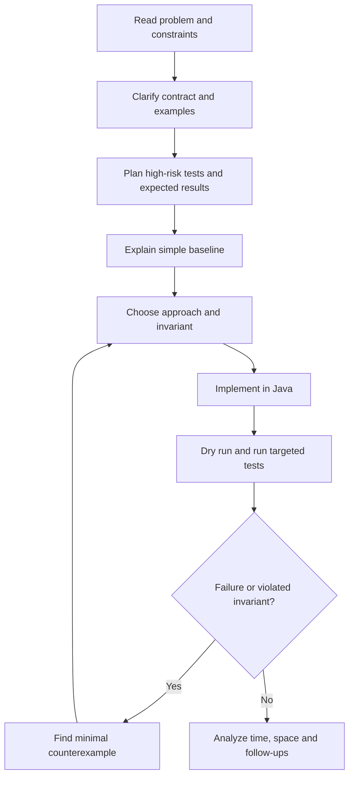
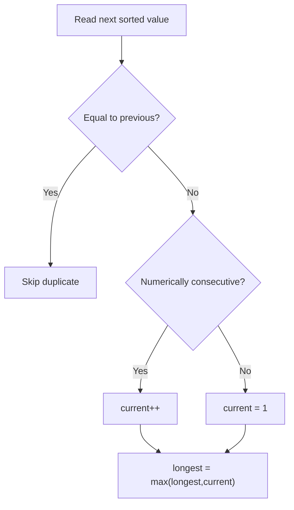
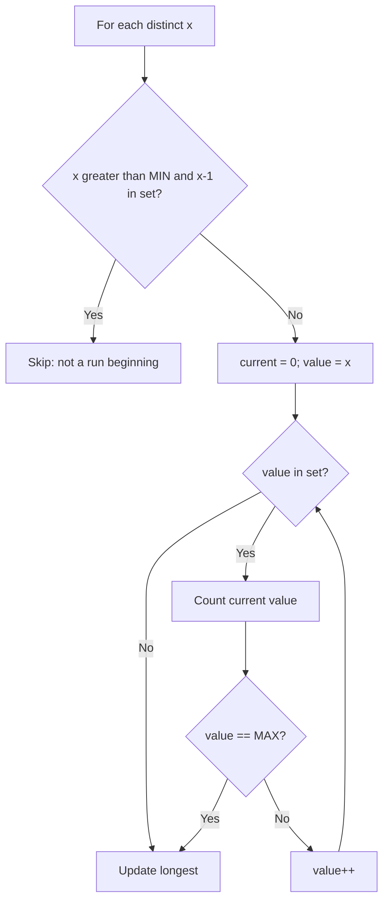

# DSA-0.03 — Correctness, Testing and Interview Coding

> **Phase:** 0 — Coding Interview Foundations  
> **Status:** **COMPLETED** (learner-confirmed on 2026-11-02)  
> **Language:** Java  
> **Goal:** Clarify a contract, construct correct implementations, identify invariants and counterexamples, write meaningful tests, and defend complexity and follow-up trade-offs.  
> **Prerequisites:** Basic Java and [DSA-0.01 Complexity](../Algorithmic-Thinking-and-Complexity/README.md); see also [DSA-0.02 Java for Interviews](../Java-for-DSA-Interviews/README.md).

**Navigation:** [Syllabus](../../../Curriculum/SYLLABUS.md#correctness-testing-and-interview-coding-dsa-003) · [Contents](../../../ProgressTracker/CONTENTS.md) · [Daily Log](../../../ProgressTracker/DAILY_LOG.md) · [Solved Java file](../../../PracticeCodes/Problems/LongestConsecutiveSequence.java) · [Regression tests](../../../PracticeCodes/Problems/LongestConsecutiveSequenceTest.java)

**How to use these notes:** They are deliberately comprehensive even though live teaching was fast and interview-focused. Some material (JUnit patterns, differential/metamorphic tests) is detailed reference, not a claim of independently practiced mastery. We will keep improving test-case selection alongside all future DSA problems rather than repeatedly studying testing in isolation.

---

## 1. Correctness is different from compilation, examples, and complexity

A function can compile, pass three obvious examples, and run in O(n) time, yet still violate its contract for an input it never anticipated. Good interview reasoning connects four questions:

| Question | Evidence |
|---|---|
| **What should happen?** | Contract, preconditions, postconditions, allowed side effects |
| **Why must it happen?** | Invariant and termination argument |
| **How could it fail?** | Boundary cases, counterexamples, test matrix |
| **What does it cost?** | Time/space bounds, expected/worst-case assumptions |

Testing provides **counterexample-finding evidence**, not a universal correctness proof. An invariant explains how every legal state transition preserves an essential property.

### Coding-interview workflow



Interview time is scarce: apply these steps compactly, without turning each problem into an academic proof.

---

## 2. Clarify the contract before choosing code

Not all “valid answers” mean the same thing. Ask clarifying questions **only when they can change the algorithm or expected output**:

1. **Input domain:** Can it be null, empty, negative or contain duplicates? Are extreme values permitted?
2. **Order:** Is the input sorted? Does numeric adjacency differ from array-index adjacency?
3. **Answer:** Count, index, value, all answers or one? What about ties or missing answers?
4. **Side effects:** Can you mutate/sort the input or must it remain unchanged?
5. **Constraints:** `n`, numeric range, memory budget, repeated operations, expected vs worst-case performance?
6. **Invalid inputs:** Are they guaranteed away, or should the API throw/return a documented result?

**Terminology:**

- **Precondition:** Must hold at method entry; e.g. input array is non-null if contract says so.
- **Postcondition:** Must hold when method returns; e.g. return correct maximum length **and** preserve caller input.
- **Invariant:** Must hold at a defined point during every iteration.
- **Termination:** Every loop makes progress to a finite endpoint.

Do not invent requirements. An invalid-input test is useful if invalid inputs are in scope; otherwise prioritize the real contract.

---

## 3. A practical pre-solution test-design framework

**Contract → input partitions → boundaries → broken assumptions → independent expected output.**

### 3.1 Equivalence partitioning

Partition the input into cases likely to exercise meaningfully different behavior. For longest consecutive sequence:

- Empty; singleton.
- All values isolated; all values consecutive.
- Repeated values; particularly a duplicate **inside** an ongoing streak.
- Unsorted input with a hidden long sequence.
- Several independent sequences of different lengths.
- Negative/positive boundaries when relevant.
- Integer extremes when proposed arithmetic may overflow.

The goal is **distinct failure-mode coverage**, not collecting many random arrays.

### 3.2 Boundary-value analysis

A boundary can be input length 0/1, `Integer.MIN_VALUE` / `MAX_VALUE`, an array-index edge, arithmetic overflow threshold, a recursion-depth limit, or a condition at which an invariant changes state.

### 3.3 Expected-output oracle

State the expected value **without executing your proposed algorithm**. During the live session, one original proposed case was:

```text
[1, 150, 32, 4] -> expected 0
```

That expectation is incorrect: it should be **1**. A singleton value itself is a consecutive sequence of length one. For this problem: empty → 0; non-empty → **at least 1**.

A test with the wrong expected output can incorrectly reject correct code or approve broken code.

### 3.4 Three tests under a tight interview budget

Start with (a) representative valid input, (b) one meaningful boundary, (c) a counterexample to the most likely faulty assumption. After picking a concrete algorithm, add **implementation-specific** tests.

**Contract-based** examples are valid regardless of implementation. **Algorithm-risk-based** tests depend on actual operations: integer overflow matters much more if the code increments values than if it only compares them. Likewise, input-preservation tests are mandatory for the contract, but lower priority in a short live test budget if the code is obviously read-only.

---

## 4. Loop invariants: initialization, maintenance, termination

A loop invariant is a precise statement known true at the **same point** in each iteration.

**Example: maximum of a non-empty array**

```java
int max = arr[0];
for (int i = 1; i < arr.length; i++) {
    if (arr[i] > max) max = arr[i];
}
```

**Invariant just before iteration `i`:** `max` equals the maximum of `arr[0..i-1]`.

- **Initialization:** At `i=1`, prefix contains only `arr[0]`, assigned to `max`.
- **Maintenance:** Checking `arr[i]` extends that prefix, retaining its maximum.
- **Termination:** At `i=n` the prefix is the entire array, so `max` is the answer.

Time O(n), auxiliary space O(1); the invariant is independent of these bounds.

```text
Array:      [ 4, -2, 7, 3 ]
After 4     max = 4
After -2    max = 4
After 7     max = 7
After 3     max = 7
```

**Be precise about the iteration boundary.** “After the first `i` values” means indices `0..i-1`, not `0..i`.

---

## 5. Case study: second-largest distinct value

**Contract:** Given a non-null `int[]`, return its second-largest **distinct** value; throw `IllegalArgumentException` if fewer than two distinct values exist. Full Java integer range is valid.

### 5.1 Initial sentinel bug

```java
int largest = Integer.MIN_VALUE;
int second = Integer.MIN_VALUE;
```

The sentinel `Integer.MIN_VALUE` is a legitimate result. Thus it ambiguously represents both “not found” and a valid second-largest.

The learner independently proposed:

| Input | Correct | Incorrect sentinel approach |
|---|---|---|
| `[1, MIN_VALUE, MIN_VALUE]` | Return `MIN_VALUE` | Returns `MIN_VALUE` |
| `[MIN_VALUE, MIN_VALUE, MIN_VALUE]` | Throw exception | Returns `MIN_VALUE` |

Checking `largest == second` at return time does **not** solve this: `[1,MIN_VALUE]` and `[1,1]` can leave identical stored values while needing different outcomes.

### 5.2 Three possible representations

- **First two observed values:** Avoid fabricated sentinels, but duplicates (e.g. `[10,10,5]`) require special treatment.
- **Nullable wrappers:** `Integer largest = null, second = null` represent absence explicitly. Use `largest == null || x > largest` to avoid null unboxing; reversing the terms produces a `NullPointerException`. Avoid `Integer` reference-identity `==` for numeric equality.
- **Primitives + flags:** `int largest, second` plus `boolean hasSecond` (and initialize largest from a guaranteed present element). This avoids boxing and expresses presence separately.

### 5.3 Correct invariant for the nullable design

After processing the first `i` values:

1. `largest == null` **iff** `i == 0`; otherwise it is the greatest value encountered.
2. `second == null` **iff** fewer than two distinct values have been encountered.
3. If `second != null`, it is the second-largest distinct value, strictly below `largest`.

**Transferable lesson:** Your state must preserve sufficient information to distinguish different required outcomes. Extra final `if` statements cannot recover information discarded earlier.

This exercise was discussed conceptually; a final independently coded and tested `secondLargestDistinct` implementation was **not** published.

---

## 6. Longest Consecutive Sequence: tests before the algorithm

**Contract for our strengthened exercise:** Unsorted `int[]`, duplicates allowed, empty returns 0, consecutive means adjacent **numeric values**, not neighboring array indices. All Java `int` values may appear. Original input must remain unchanged.

The learner proposed a five-case pre-solution suite:

| Input | Expected | Test intent |
|---|---:|---|
| `[]` | 0 | Empty |
| `[2,2,3,3]` | 2 | Duplicates are not counted twice |
| `[1,150,32,4]` | **1** | No consecutive pair (expected value corrected from 0) |
| `[4,2,1,3]` | 4 | Fully consecutive but unsorted |
| `[1,7,35,9,39,99,38,3,27,36,24,37]` | 5 | Scattered unsorted 35–39 streak |

**Correctness property:** Empty array ⇒ answer 0; non-empty array ⇒ answer at least 1 and no greater than its number of distinct elements.

### 6.1 Review a deliberately flawed sorted solution

```java
Arrays.sort(nums);
int current = 1, longest = 1;
for (int i = 1; i < nums.length; i++) {
    if (nums[i] == nums[i - 1] + 1) current++;
    else current = 1;
    longest = Math.max(longest, current);
}
return longest;
```

The learner independently identified two real bugs:

1. `[]` yields 1 instead of 0.
2. `[1,2,3,3,4]` yields 3 instead of 4: a duplicate incorrectly breaks the streak.

A third **contract violation** applies if input mutation is forbidden: `Arrays.sort(nums)` sorts the caller's array in-place. If mutation is allowed, it is *not* a bug.

**Important reachability nuance:** An attempted counterexample `[MIN_VALUE, MAX_VALUE]` does not break this specific sorted adjacent comparison. Once equal values are handled, the predecessor in the comparison must be smaller than the current value; an overflowing `MAX_VALUE + 1` branch cannot occur. Don't claim a bug based solely on a potentially dangerous expression without checking reachable conditions.

---

## 7. Correct learner-written sorting solution

The learner corrected the sort approach by:

1. Early-returning 0 on empty input.
2. Sorting `nums.clone()` to honor input preservation.
3. Ignoring duplicates without changing the streak length.
4. Extending only when the next *distinct* value is consecutive.
5. Maintaining `longest` independently of `current`.

See [`longestConsecutiveBySorting`](../../../PracticeCodes/Problems/LongestConsecutiveSequence.java) for the reviewed Java implementation.

### State transition visual



### Detailed dry run

Input sorted to `[1,2,2,3,6,7]` (caller input remains intact):

| Value processed | Transition | `current` | `longest` |
|---:|---|---:|---:|
| 1 | Initialize | 1 | 1 |
| 2 | Extend | 2 | 2 |
| 2 | Duplicate; ignore | 2 | 2 |
| 3 | Extend | 3 | 3 |
| 6 | Gap; reset | 1 | 3 |
| 7 | Extend | 2 | 3 |

**Invariant:** After each processed sorted prefix, `current` is the length of the run ending at its largest distinct value; `longest` is the maximum run found in that prefix.

**Argument:** Sorted distinct values form contiguous runs separated by gaps; every run is counted, duplicates cannot split one, and the maximum is retained.

**Cost:** Sorting O(n log n) and scanning O(n); cloning `int[]` requires O(n) auxiliary space. This is a valid alternative when expected linear time is not required.

---

## 8. Follow-up: expected O(n) using Java HashSet

When the interviewer changes the requirement to expected O(n), the decisive observation is that we need to test **membership**, not recover a total sort order.

Build a `HashSet<Integer>`. A value `x` can start a maximal run **only if `x-1` does not exist**. Count successors only from these run starts.

```text
Input: [100, 4, 200, 1, 3, 2]
Set:   {1, 2, 3, 4, 100, 200}  // conceptual; iteration unordered

Start 1   -> 1, 2, 3, 4    length 4
Start 100 -> 100           length 1
Start 200 -> 200           length 1
2, 3, 4 are skipped; each has a predecessor.
```

### HashSet approach diagram



### Learner-led debugging

The learner's first HashSet implementation correctly built a set and found run beginnings, but had two bugs:

- **Stale per-run state:** `current` was declared outside the outer loop and reset only when skipping non-starts. Distinct run beginnings could be visited consecutively in unspecified HashSet iteration order, accidentally accumulating their lengths. Move/reset `current` inside each run.
- **Overflow in forward scan:** `while (set.contains(val++))` can increment `MAX_VALUE` and wrap to `MIN_VALUE`. Count MAX, then stop **before** incrementing it. The predecessor check already protects `MIN_VALUE - 1`.

See corrected [`longestConsecutiveByHashSet`](../../../PracticeCodes/Problems/LongestConsecutiveSequence.java). It is **learner-written after receiving the optimized approach and debugging feedback**.

### Why nested loops are expected O(n)

Let `m` be distinct values and let maximal runs have lengths `L1 ... Lk`.

```text
L1 + L2 + ... + Lk = m  (m <= n)
Set construction:          expected O(n)
Outer start checks:         expected O(m)
All successful inner scans: expected O(m) in aggregate
Final failed checks:        at most O(k) extra, with k <= m
```

Only the **minimum** of each maximal run triggers a full forward scan; no other element starts another scan of the same run. Thus each distinct value contributes a constant amount of aggregate work. Total **expected O(n)** time and **O(n)** auxiliary space.

**Hashing assumption:** Ordinary Java `HashSet` membership is expected O(1), not guaranteed worst-case O(1). The Java HashMap implementation may treeify crowded bins under conditions, but unqualified deterministic worst-case linear total time would be an overclaim.

### Correctness argument

- Each maximal consecutive run has a unique smallest element without a predecessor.
- That smallest element appears in the set and is processed as a run start.
- Forward membership counting visits every value in that run until the first gap or `MAX_VALUE`.
- Since no other value in that run passes the “no predecessor” test, its elements are not scanned again as another run.
- `longest` is the largest length among runs processed so far. After all starts, every run has been considered.

This provides both **completeness** and **no double counting**, independent of HashSet iteration order.

---

## 9. Final deterministic test matrix

The first seven tests below were independently designed by the learner. The additional tests targeted remaining implementation risks.

| Input | Expected | Coverage |
|---|---:|---|
| `[]` | 0 | Empty (learner) |
| `[4,2,1]` | 2 | Typical unsorted (learner) |
| `[3]` | 1 | Singleton (learner) |
| `[6,2,7,10,6,8,10,9]` | 5 | Scattered + duplicates (learner) |
| `[MAX,MAX-1,0,MIN,MIN+1,MIN+2]` | 3 | Full-range boundary (learner) |
| `[10,20,30]` | 1 | No consecutive pair (learner) |
| `[1,2,3,6,7,8,9]` | 4 | Multiple runs (learner) |
| `[1,2,2,3,4]` | 4 | Duplicate within active run (mentor) |
| `[MAX,MIN]` | 1 | Prevent wraparound (mentor) |
| `[-3,-2,-1,0,1]` | 5 | Negative-to-zero transition (mentor) |
| `[100,4,200,1,3,2]` | 4 | Standard explanatory example |

`MIN`/`MAX` denote `Integer.MIN_VALUE` / `Integer.MAX_VALUE`.

**Additional postcondition:** Input array unchanged. To test it, clone input before calling the method, then compare `Arrays.equals(input, original)` or `assertArrayEquals` in JUnit 5.

---

## 10. JUnit 5 and contract-focused Java tests

JUnit is familiar developer tooling; this chapter's essential point is choosing **meaningful assertions** rather than learning annotation syntax.

```java
import static org.junit.jupiter.api.Assertions.*;
import org.junit.jupiter.api.Test;

class LongestConsecutiveJUnitExample {
    @Test
    void ignoresDuplicatesAndPreservesInput() {
        int[] input = {1, 2, 2, 3, 4};
        int[] snapshot = input.clone();

        int answer = LongestConsecutiveSequence
                .longestConsecutiveByHashSet(input);

        assertEquals(4, answer);
        assertArrayEquals(snapshot, input);
    }
}
```

Use `assertThrows(IllegalArgumentException.class, ...)` only for an API whose contract **actually specifies** an exception. Example: our separate second-largest-distinct exercise promised an exception for all-equal input. Do not invent invalid-input expectations if a coding platform guarantees valid input.

**Testing workflow:** Name test by behavior → Arrange input and independent expected value → Act → Assert return and relevant side effects → Retain regressions when bugs are found.

**About Java interfaces:** `HashSet` / `Set` (membership), `Arrays.sort` (mutating sort), `clone` (primitive-array copy), and assertion APIs were used when relevant. Deeper Java collection internals remain paired with future DSA chapters under the integrated-Java teaching policy.

---

## 11. Differential testing, oracles and extra test confidence

When a fast solution is difficult to trust, implement a simple **independent baseline oracle** on small inputs:

1. Generate a small valid input.
2. Compute expected output with a simple, deliberately different method.
3. Compare sorting and HashSet implementations to that oracle.
4. Also compare input before/after calls.
5. On failure, shrink the input to a tiny counterexample.

The [mentor-authored dependency-free test harness](../../../PracticeCodes/Problems/LongestConsecutiveSequenceTest.java) does precisely this.

For every ordered array of length 0–5 drawn from

```text
{-2, -1, 0, 1, 2, Integer.MIN_VALUE, Integer.MAX_VALUE}
```

the number of generated cases is:

```text
1 + 7 + 7² + 7³ + 7⁴ + 7⁵ = 19,608
```

Plus 11 hand-picked tests = **19,619** cases. The harness uses a slow independent value-membership oracle and checks both reviewed algorithms and input preservation.

**Validation:** Compiled and executed with Java 21 at publication preparation. The dependency-free tests passed. This is strong evidence against a range of bugs, not an exhaustive proof over the entire Java integer/input-length domain.

### Additional test properties (use when relevant)

- Permuting input order does not change the result.
- Adding a duplicate does not change the result.
- For a non-empty input, answer ∈ [1, number of distinct values].
- Adding a value cannot decrease the maximum run length.
- Translating all values by the same offset without overflow leaves run lengths unchanged.

These are **metamorphic properties**: they test relationships between outputs even when exact outputs are hard to compute. Not a mandatory extra exercise for every problem.

---

## 12. Interview-quality debugging and correctness checklist

**Before writing code:** Clarify contract; state input/output restrictions; choose representative, boundary and adversarial test cases; propose baseline and target complexity.

**During coding:** Maintain the invariant; keep per-run state scoped correctly; avoid using legitimate data values as “not found” flags; check numeric limits; preserve input if required.

**After coding:** Trace a small case; attack with a counterexample; assert side effects; validate complexity; explain one realistic changed requirement.

### Common mistakes and fixes

| Mistake | Better approach |
|---|---|
| “Nested loops → always O(n²)” | Count aggregate successful inner iterations |
| A legitimate `int` doubles as missing sentinel | Explicit presence/absence state |
| Check numeric comparison before nullable guard | Use short-circuit-safe guard ordering |
| `Integer` references compared with `==` | Value equality, with null handling |
| Duplicates reset a distinct-number streak | Skip without changing current or longest |
| Carry current run length between separate runs | Scope counter per run |
| `MAX_VALUE + 1` wraps to `MIN_VALUE` | Guard before increment where reachable |
| Assume sort is read-only | Clone input first if mutation forbidden |
| HashSet has sorted iteration | Never depend on iteration order |
| Worst-case O(1) assumed for hash lookups | Say **expected** O(1) and explain assumption |
| Tests only assert output | Assert required non-mutation, exception or ordering |
| Excessive irrelevant edge cases | Choose tests proportional to contract and code risk |

### How to explain a solution in an interview

> “The input contract is [X], including [key edge/side effect]. A straightforward baseline is [Y] at [cost]. My optimized approach preserves [invariant], meaning [why it covers every valid answer]. It takes [time] and [space], under [assumption], and I would test [high-risk cases].”

A confident, concise explanation beats memorized jargon.

---

## 13. Principal/Architect follow-up scenarios

| Changed requirement | Expected discussion |
|---|---|
| 10 million integers, expected linear-time target | HashSet start-only scan; discuss memory and boxing overhead |
| Strict low-memory runtime | Maybe allow input sorting/in-place work; otherwise assess feasibility |
| Cannot mutate input | Clone before sorting or use read-only scan/set |
| Hard worst-case latency | Hash-based expected guarantees may be insufficient |
| Very frequent updates or repeated queries | One-time scan may not fit; evaluate indexed/incremental design |
| Full 32-bit domain | Explicit overflow checks at MIN/MAX boundaries |
| Concurrent access | Ordinary mutable HashSet is not thread-safe |
| Very large numeric workload | HashSet<Integer> memory allocations/boxing can matter in Java |

Time/memory trade-offs and API behavior should follow from the exact changed requirement, not an automatic “use a faster data structure” claim.

---

## 14. Solved Practice Questions — actual reviewed Java links

| Problem | Approach | Java source | Assistance evidence |
|---|---|---|---|
| [LeetCode 128 — Longest Consecutive Sequence](https://leetcode.com/problems/longest-consecutive-sequence/) (our exercise adds input-preservation + all `int` boundaries) | Sorting a cloned array, duplicate-aware scan | [`longestConsecutiveBySorting`](../../../PracticeCodes/Problems/LongestConsecutiveSequence.java) | **Learner-written and reviewed** |
| Same problem, optimized | HashSet scan from run starts | [`longestConsecutiveByHashSet`](../../../PracticeCodes/Problems/LongestConsecutiveSequence.java) | **Learner-written after mentor taught the pattern; mentor-assisted debugging** |

**Separate test artifact:** [`LongestConsecutiveSequenceTest.java`](../../../PracticeCodes/Problems/LongestConsecutiveSequenceTest.java) is a **mentor-authored** test harness built from the learner's test ideas plus additional cases and an independent oracle. Do **not** count it as independently learner-authored JUnit code.

To run in a Java installation without adding project dependencies:

```bash
cd PracticeCodes/Problems
javac LongestConsecutiveSequence.java LongestConsecutiveSequenceTest.java
java LongestConsecutiveSequenceTest
```

Expected output:

```text
PASS: 19619 cases; both methods and input preservation verified
```

---

## 15. Additional LeetCode Practice — optional

| Problem | Why useful | Official URL | Chapter evidence |
|---|---|---|---|
| 268 — Missing Number | Clarify contract, endpoint cases, overflow and oracles | https://leetcode.com/problems/missing-number/ | Suggested; not independently coded here |
| 1796 — Second Largest Digit in a String | Missing-state representation and duplicate semantics | https://leetcode.com/problems/second-largest-digit-in-a-string/ | Suggested; not independently coded here |

These are **not** extra completion blockers; revisit them only when the respective algorithm/topic makes them useful. The custom second-largest-**array** exercise is distinct from LeetCode 1796.

---

## 16. Concept checkpoints and answer key

**Checkpoints:**

1. Why can an algorithm pass 1000 tests and still be wrong?
2. What are the three parts of the standard loop-invariant argument?
3. What is wrong with `int second = Integer.MIN_VALUE` as a “not found” representation when MIN_VALUE is valid input?
4. Why is `[1,150,32,4]` answer 1 rather than 0?
5. When is sorting the input a correctness bug?
6. What is the difference between contract-based and implementation-specific tests?
7. Why doesn't the HashSet approach require O(n²) even though it contains nested loops?
8. Why can the sorted adjacent scan safely use `prev+1` while an unguarded HashSet forward scan cannot?
9. What does `assertArrayEquals(snapshot, input)` verify beyond result correctness?
10. What can an independent differential oracle provide, and what cannot it prove?

**Answer key:**

1. Tests cover sampled inputs, not every valid input. Reason with invariant and all reachable transitions.
2. Initialization, preservation/maintenance, termination implies postcondition.
3. It collides with a legitimate result, losing missing-vs-present information.
4. Every individual number is a valid consecutive run of length one.
5. Only when the contract forbids mutating the caller's array.
6. Contract tests hold for any implementation; algorithm-risk tests target specific choices (sorting, arithmetic, data representation).
7. Only maximal run beginnings scan forward; across all scans each distinct value is counted once.
8. Sorted distinct comparisons imply the next value is greater, so `prev==MAX` cannot reach a valid following element; HashSet traversal may increment MAX and wrap.
9. The required input-preservation side-effect contract.
10. It exposes mismatches and yields counterexamples on finite test domains; it cannot prove the algorithm for unrestricted inputs.

---

## 17. Honest assessment, completion, and next chapter

**Independently demonstrated:**

- Designed pre-solution test categories and specific arrays, including duplicate and boundary cases.
- Identified empty-array and duplicate-reset bugs in a flawed sorting scan.
- Diagnosed ambiguous sentinel state in second-largest-distinct and proposed alternative representations; initial fixes were then challenged by counterexamples.
- Wrote the corrected sorting-based and HashSet-based Java implementations.
- Challenged why nested loops weren't quadratic, then understood aggregate scanning.
- Explained expected O(1) hashing assumptions and worst-case limitations.

**Mentor-assisted and not independently certified:** HashSet-start algorithm idea was taught before the learner implemented it; first implementation had per-run state and MAX_VALUE overflow bugs found during review. The test harness/oracle and JUnit-style explanation were mentor-authored. Timed unseen coding/JUnit proficiency has not been assessed.

**Completion:** **DSA-0.03 COMPLETED on explicit learner approval, 2026-11-02**. Completed means the lesson, reviewed code, notes and tracking lifecycle ended; it is not a claim of full independent mastery or a numerical discussion rating.

**Continuing agreement:** Test-case design is a **habit practiced with each meaningful future problem**, not a separate repetitive course. Before solutions, choose a small risk-driven suite; afterward add targeted implementation-specific tests. Notes will remain detailed.

**Next:** [DSA-1.01 — Arrays, Strings and Hashing](../../../Curriculum/SYLLABUS.md#arrays-strings-and-hashing-dsa-101), beginning Phase 1. Pair corresponding Java APIs with the topic, fast-track familiar syntax, and prioritize meaningful problem-solving.
