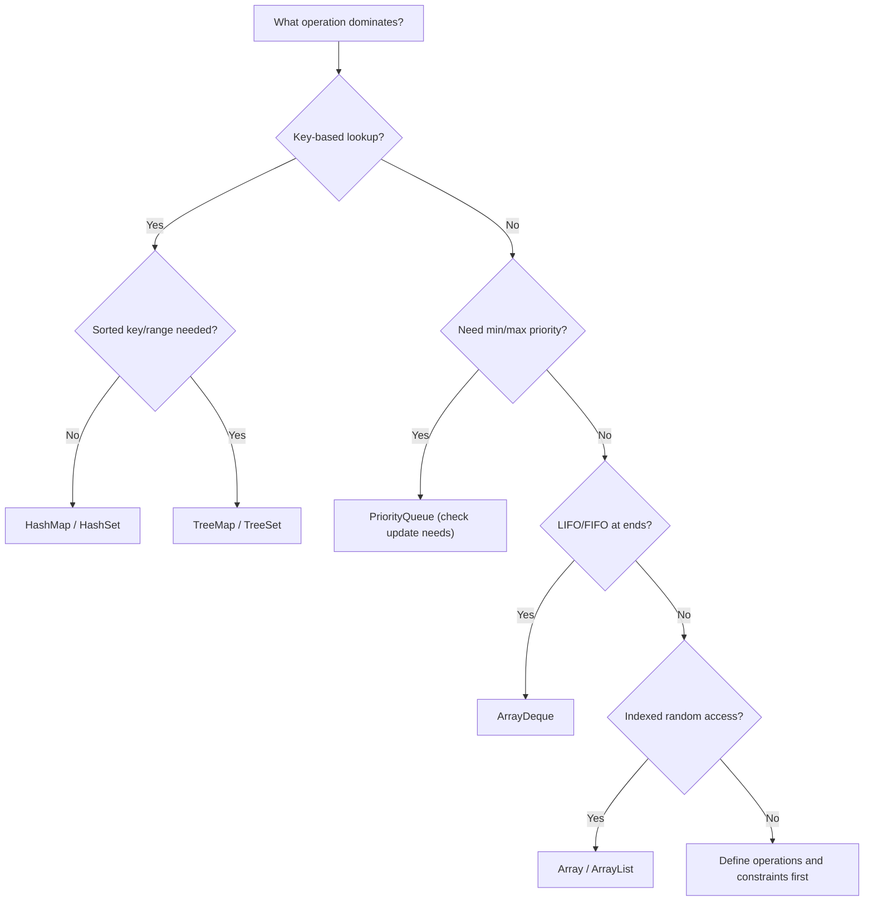
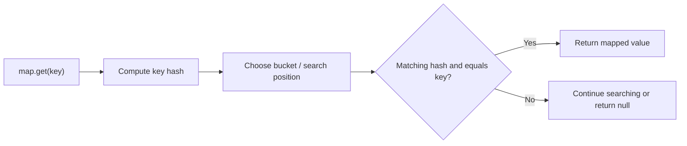
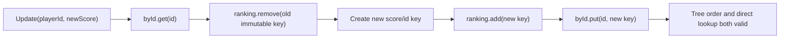

# DSA-0.02 — Java for DSA Interviews

> **Phase:** 0 — Coding Interview Foundations  
> **Chapter status:** COMPLETED (learner-confirmed, 2026-11-02)  
> **Primary language:** Java  
> **Prerequisites:** Basic Java syntax, classes, loops and references; [DSA-0.01 — Algorithmic Thinking and Complexity](../Algorithmic-Thinking-and-Complexity/README.md).  
> **Objective:** Choose the right Java representation and APIs, understand correctness and complexity traps, and implement interview algorithms without avoidable language/library mistakes.  
> **Scope decision:** This is a **complete reference note**, not a claim that every API was practiced live. Per the [integrated Java teaching rule](../../../CopilotInstructions/TEACHING_AND_VISUALS_PLAYBOOK.md), deeper collection implementation and hands-on usage are taught together with their matching later DSA chapters.

**Navigation:** [Syllabus](../../../Curriculum/SYLLABUS.md#java-for-dsa-interviews-dsa-002) · [Chapter index](../../../ProgressTracker/CONTENTS.md) · [Learning log](../../../ProgressTracker/DAILY_LOG.md)

## Learning goals and how to use this note

After studying and revisiting these examples, a candidate should be able to:

1. Select an array, dynamic array, map, set, ordered map/set, deque, heap or string builder based on operations and constraints.
2. Know the most useful Java API syntax and the relevant **actual Java API** cost rather than assuming every abstract data-structure operation is exposed efficiently.
3. Write reliable comparators, avoid hash/equality and mutable-key traps, and distinguish identity from equality.
4. Reason about reference mutation, generics, boxing, copying, allocation, iteration order, null behavior and overflow.
5. Make deliberate design trade-offs for frequency tables, queues, top-K selection and dynamically updated leaderboards.
6. Test the surprising cases, not just the happy path.

**Lesson versus reference:** This note intentionally has far more detail than the short live session. Sections on hashing and the leaderboard reflect actual discussion. Sections on other APIs are reference material and **not individually assessed**; they are scheduled to be reinforced in future chapters. Code fragments are *illustrative teaching snippets*, not files the learner independently coded and committed.

---

## 1. Mental model: choose by operation, not by class name

Think of a live cricket scoreboard with one million player records:

- `playerId → score`: hash lookup.
- Players ordered by rank: sorted structure keyed by ranking tuple.
- Highest current score: max-priority queue, **if** update semantics fit.
- Recent events: FIFO queue.
- Top ten repeatedly under arbitrary score changes: need dynamic ordered indexing, not just a heap.
- Append an event log: amortized append to an array-backed list or text builder.

An interface expresses **available operations**; its implementation determines performance and constraints. `Map` and `List` are contracts, `HashMap` and `ArrayList` are typical implementations.

### Selection diagram



This is only a **first-pass choice**. Constraints such as stable iteration order, duplicates, thread safety, and required update complexity can change the answer.

### Operation cost comparison

`n` is the number of stored elements; balanced-tree costs are worst-case logarithmic, while hashing costs are average/expected under ordinary assumptions.

| Structure | Key/index lookup | Add/update | Remove | Order / caveats |
|---|---|---|---|---|
| `int[]` / `T[]` | O(1) index | O(1) replace; insert shifting O(n) | O(n) shift | Fixed length; contiguous indices |
| `ArrayList<T>` | O(1) `get(i)` | Append amortized O(1); insert O(n) | At index O(n) due to shift (last element O(1)) | Indexed; resizing may copy |
| `HashMap<K,V>` | Expected O(1) | Expected O(1) | Expected O(1) | No iteration-order guarantee |
| `HashSet<T>` | Expected O(1) membership | Expected O(1) | Expected O(1) | Unique by equality; no order guarantee |
| `TreeMap<K,V>` | O(log n) | O(log n) | O(log n) | Sorted by key; range queries |
| `TreeSet<T>` | O(log n) | O(log n) | O(log n) | Sorted, unique by comparison |
| `ArrayDeque<T>` | No indexed lookup API | O(1) amortized operations at either end | O(1) amortized at ends | Queue/stack/deque, not sorted |
| `PriorityQueue<T>` | `peek` O(1) | `offer` O(log n) | `poll` O(log n); `remove(Object)` O(n) | Heap root only; iteration not sorted |
| `StringBuilder` | `charAt` O(1) | Append amortized O(1) for fixed-size input | Interior edits O(n) | Mutable UTF-16 text buffer |

Do not conflate capacity, size, output memory, comparator order, collection order or worst-case guarantees.

---

## 2. Arrays and ArrayList

### Arrays

```java
int[] a = new int[5];               // length 5; default values 0
int[] b = {4, 9, 1};
int n = b.length;                    // field, not method
Arrays.sort(b);                      // changes original array
int[] copy = Arrays.copyOf(b, b.length);
int[] slice = Arrays.copyOfRange(b, 1, 3); // end exclusive
Arrays.fill(a, -1);
```

- Primitive arrays store primitive values; object arrays store references.
- Arrays have fixed length, O(1) access by index, and O(n) traversal/copy.
- `System.arraycopy(src, srcPos, dest, destPos, count)` is useful for contiguous copies.
- Java multi-dimensional arrays are arrays of arrays: `int[][] grid` may have uneven row lengths.
- `Arrays.equals(a,b)` compares matching one-dimensional array contents; `Arrays.deepEquals` is for nested array content.
- `Arrays.binarySearch(sorted, key)` needs sorted input (per the relevant sort order); negative result encodes insertion point. Do not binary-search an unsorted array.
- `Arrays.asList(intArray)` with `int[]` creates a **single-element list whose element is the entire int[]**; it does *not* autobox each integer.

### Dynamic array / ArrayList

```java
List<Integer> list = new ArrayList<>(100_000);
list.add(7);
list.add(9);
int first = list.get(0);
list.set(1, 10);
list.remove(0);                 // removes by index
list.remove(Integer.valueOf(10)); // removes by value
```

- `new ArrayList<>(100_000)` sets initial **capacity**, not logical size: immediately after creation, `list.size() == 0`, and `list.get(0)` throws.
- Appends are **amortized O(1)**; occasional resize needs O(n) copying. Preallocating when size is known reduces those resizes.
- Inserting/removing at the front or middle shifts a suffix and costs O(n).
- `ArrayList<Integer>` stores references to boxed `Integer` objects, not a compact `int[]`.
- `Arrays.asList(1,2,3)` is a fixed-size list backed by its object array: `set` works, `add/remove` throw. `List.of(1,2,3)` is unmodifiable and rejects null elements.
- Use indexed loops with `ArrayList` when random access is important. Do **not** assume `LinkedList.get(i)` is O(1); it is O(n) in general.
- During enhanced-for iteration, modifying an ordinary `ArrayList` structurally outside the iterator may trigger `ConcurrentModificationException` (fail-fast best effort, not a synchronization guarantee). Use `Iterator.remove()` or an explicit safe strategy when needed.

**ArrayList resize trace (illustrative, not a promise of a specific growth factor):**

```text
capacity 4, size 4: [A B C D]
append E          : need capacity > 4
allocate larger array and copy existing 4 references
new storage        : [A B C D E _ ...]
one append can cost O(n), many appends average to amortized O(1)
```

### Arrays versus ArrayList

Prefer an `int[]` for numeric hot loops, known fixed lengths, compact primitive storage and simple in-place algorithms; prefer `ArrayList<T>` for dynamically sized object sequences and convenient API. Beware `List<Integer>` allocation/unboxing overhead in high-volume numeric algorithms.

---

## 3. Strings, characters and StringBuilder

Java `String` is immutable: concatenation creates a new string value. In repeated construction:

```java
StringBuilder sb = new StringBuilder();
for (int i = 0; i < 5; i++) {
    sb.append(i).append(',');
}
String output = sb.toString();
```

Repeated `s = s + piece` in a loop may repeatedly copy growing prefixes and be quadratic overall for many small pieces (actual optimization depends on context). `StringBuilder` appends in amortized time proportional to appended data, so total construction is linear in output size for typical usage.

Useful methods: `length()`, `charAt(i)`, `substring(begin,end)` (end exclusive), `indexOf`, `toCharArray()`, `StringBuilder.append/insert/delete/reverse/setCharAt`. `StringBuilder` is not thread-safe; `StringBuffer` uses synchronized methods.

**Unicode nuance:** `char` and `String.length()` count UTF-16 *code units*, not necessarily user-perceived characters. Some Unicode code points take two `char` values (surrogate pair), and a visible grapheme can consist of multiple code points. For code-point-aware scanning use `codePoints()` or `codePointAt` plus `Character.charCount`. Do not overcomplicate ASCII-only interview inputs, but clarify the contract when international text matters.

### String equality

`"abc".equals(other)` tests content; `==` tests reference identity. Use `Objects.equals(a,b)` for nullable values, or `"literal".equals(candidate)` when the left side is known non-null.

---

## 4. Java hashing: HashMap, HashSet, equality and collisions

`HashMap<K,V>` associates a key with a value; `HashSet<T>` tracks membership. Both use hashing and equality. Two distinct concepts matter:

- `hashCode()` chooses where to *look* (conceptually a bucket after hash spreading/indexing).
- `equals()` decides whether a candidate key *matches*.
- If `a.equals(b)` is true, `a.hashCode() == b.hashCode()` **must** be true. The converse is not required: collisions are legal.
- Consistent equality is also required: reflexive, symmetric, transitive and consistent while the objects remain compared.

### HashMap lookup sketch



Actual JDK implementations have more details (hash mixing, bucket entries, and possible collision treeification). What matters for interviews: **expected O(1)** for ordinary well-distributed hashing, not a guaranteed O(1) worst case.

### Idiomatic frequency and membership API

```java
Map<String, Integer> count = new HashMap<>();
count.merge("red", 1, Integer::sum); // 1, then 2 on next call
count.put("blue", count.getOrDefault("blue", 0) + 1);

Set<Integer> seen = new HashSet<>();
boolean firstAppearance = seen.add(42); // true, then false
boolean present = seen.contains(42);
```

`getOrDefault` returns the mapped value if the key exists, even if that mapped value is `null`; it is *not* equivalent to “replace any null with default”. `containsKey` distinguishes absent from present-with-null. `HashMap` permits one null key and null values; `HashSet` permits one null element. Neither guarantees iteration order; `LinkedHashMap` maintains a defined encounter order (typically insertion order).

### Custom value-based key

```java
final class EmployeeKey {
    private final int id;
    EmployeeKey(int id) { this.id = id; }

    @Override public boolean equals(Object other) {
        if (this == other) return true;
        if (!(other instanceof EmployeeKey)) return false;
        EmployeeKey that = (EmployeeKey) other;
        return id == that.id;
    }
    @Override public int hashCode() {
        return Integer.hashCode(id);
    }
}
```

For multi-field keys, use the same equality-relevant fields in both functions. Java `record` can automatically generate value-based `equals` and `hashCode` for its components (but record components that are references may still point at mutable objects). `Objects.hash(...)` is convenient but may have varargs/boxing overhead; measure only if it matters.

### Mutable key trap — actually discussed live

```java
class Employee {
    int id;
    Employee(int id) { this.id = id; }
    @Override public boolean equals(Object o) {
        return o instanceof Employee && id == ((Employee) o).id;
    }
    @Override public int hashCode() { return Integer.hashCode(id); }
}

Employee emp = new Employee(101);
Map<Employee, String> map = new HashMap<>();
map.put(emp, "Developer");
emp.id = 202;
System.out.println(map.get(emp)); // null for this example
```

At insertion, the hash derived from 101 determined placement. After changing the field to 202, retrieval calculates a **different hash** and searches the wrong place. The object identity did not change, but the map has not re-indexed its entry.

Under the example's default table capacity of 16, the illustrative bucket indices are 5 for 101 and 10 for 202. **Different hash codes do not always imply distinct buckets**, but they do make hash-based retrieval unsafe after mutation.

**Invariant:** While an object serves as a hash key, do not mutate any field used by its equality/hash behavior. Prefer immutable key records/value objects.

### Equality and identity gotchas

- `==` for two object references checks identity; `equals` may check values.
- `HashMap` uses logical key equality; `IdentityHashMap` deliberately uses reference identity (rare in coding interviews).
- A custom class overriding `equals` without a compatible `hashCode` can make logically equal objects fail map/set lookup.
- A poor hashCode that always returns the same value creates collisions and hurts performance.
- Removing while iterating? Use supported iterator APIs, `removeIf` on suitable collections, or collect keys to remove separately.

---

## 5. Ordered indexing: TreeMap and TreeSet

`TreeMap` implements `NavigableMap`; `TreeSet` implements `NavigableSet`. They keep keys/elements sorted using a natural order or supplied `Comparator`. Java implementations are backed by a balanced red-black tree, yielding O(log n) lookup/insert/remove.

Useful navigation APIs:

```java
NavigableMap<Integer, String> schedule = new TreeMap<>();
schedule.put(10, "A");
schedule.put(20, "B");
schedule.put(40, "C");

schedule.floorKey(25);     // 20, largest key <= 25
schedule.ceilingKey(25);   // 40, smallest key >= 25
schedule.lowerKey(20);     // 10
schedule.higherKey(20);    // 40
schedule.firstKey();       // 10
schedule.lastKey();        // 40
schedule.descendingMap();  // reversed navigable view
```

`TreeSet` similarly offers `floor`, `ceiling`, `lower`, `higher`, `first`, `last` and `descendingSet`. Views such as `subMap` and `subSet` support range access but are backed by the original collection. Range traversal is generally O(log n + number of returned entries).

**Important semantics:**

1. Ordering comes from the *comparator*, not from `hashCode`.
2. If `compare(a,b) == 0`, a `TreeSet` considers them the same set element; a `TreeMap` treats them as the same key. To preserve distinct players with equal score, use a tie-breaker (e.g. player ID).
3. **Mutating an ordering field in an element already in a TreeSet/TreeMap does not move it.** Remove the old ordered key first, then add the new key. Immutable ordered keys are safest.
4. Null natural-order keys are generally invalid; comparator rules may vary. Avoid null if not explicitly supported.

### Ordered-key illustration

```text
Sorted keys:  [10] [20] [40]
floor(25)            ^ returns 20
ceiling(25)                    ^ returns 40
add(30):     [10] [20] [30] [40]   O(log n) balanced-tree insertion
```

Don't confuse `TreeMap` (sorted *keys*) with automatic sorting by a mutable `value`. A `TreeMap<PlayerId, Score>` is ordered by player ID, not by score.

---

## 6. Stack, queue and deque: Deque / ArrayDeque

`Deque<E>` is a double-ended queue interface; `ArrayDeque<E>` is a resizable array-backed implementation well suited to stack and queue patterns.

```java
Deque<Integer> stack = new ArrayDeque<>();
stack.push(10);      // addFirst
stack.push(20);
int top = stack.peek(); // 20
stack.pop();          // 20

Deque<Integer> queue = new ArrayDeque<>();
queue.offerLast(10);
queue.offerLast(20);
int head = queue.pollFirst(); // 10
```

| Desired action | Stack API | Queue API | Deque API |
|---|---|---|---|
| Insert | `push(x)` | `offer(x)` | `offerFirst/offerLast` |
| Inspect | `peek()` | `peek()` | `peekFirst/peekLast` |
| Remove | `pop()` | `poll()` | `pollFirst/pollLast` |

`peek/poll` usually return null if empty; `pop/remove` throw when empty. `ArrayDeque` **forbids null elements**, making null a reliable empty sentinel. End operations are amortized O(1) for normal usage. It does not expose arbitrary index lookup. Prefer `ArrayDeque` rather than legacy `Stack` for typical single-threaded interview solutions.

### FIFO trace

```text
empty
offerLast(7)   -> front [7] back
offerLast(9)   -> front [7, 9] back
pollFirst()    -> returns 7; remaining [9]
```

When a bounded, blocking or concurrent queue is required in real production code, the correct API may instead come from `java.util.concurrent`. Ordinary `ArrayDeque` is **not** thread-safe.

---

## 7. Heap / PriorityQueue: the important non-obvious semantics

`PriorityQueue<E>` is Java's binary-heap priority queue. The root is the **least** element according to its comparator (a min-heap by default).

```java
PriorityQueue<Integer> min = new PriorityQueue<>();
PriorityQueue<Integer> max =
    new PriorityQueue<>(Comparator.reverseOrder());

min.offer(8);
min.offer(3);
min.offer(5);
min.peek();  // 3, O(1)
min.poll();  // 3, O(log n)
```

| API | Complexity | Meaning |
|---|---|---|
| `peek()` | O(1) | Read best priority, does not remove |
| `offer(x)` | O(log n) | Insert and restore heap invariant |
| `poll()` | O(log n) | Remove root and restore invariant |
| `contains(x)` | O(n) | Linear search |
| `remove(Object x)` | O(n) | Find arbitrary element by equality, then repair heap |
| `iterator()` | O(n) traversal | **Not** sorted priority order |
| Build from collection | O(n) heap construction | Bulk heapify in common constructors |

A heap only guarantees its parent/child ordering invariant. It does **not** imply that its internal array or iterator is fully sorted.

### Illustrative max-heap trace

```text
          A:90
         /    \
      B:70   C:50       valid max-heap

Directly mutate C.score = 100:

          A:90
         /    \
      B:70   C:100      INVALID heap ordering
```

**Java PriorityQueue does not detect or respond to changes in objects it stores.** `peek()` may continue to return A:90 because no heap operation reindexed C. This invalidates the live-session assumption “mutate score, comparator will automatically reorder”.

The naive repair strategy:

```java
heap.remove(existingPlayer); // O(n) in PriorityQueue
// update score only after removal
heap.offer(updatedPlayer);   // O(log n)
```

This is O(n) due to arbitrary removal. Other approaches: lazy-invalidation/versioned heap records (updates O(log n), discard stale entries during reads and occasionally rebuild) or an ordered balanced tree with stable keys (O(log n) remove/reinsert).

**Design rule:** If you require frequent arbitrary *decrease-key/increase-key* updates, Java's standard PriorityQueue lacks an indexed-key adjustment API. Model the update strategy explicitly; do not assume the abstract heap operation is exposed.

---

## 8. Sorting, Comparator and Comparable

`Comparable<T>` gives a type its natural ordering, via `compareTo`. `Comparator<T>` specifies an external/contextual ordering. Comparator results need only be negative, zero, or positive: **not necessarily -1/0/1**.

```java
class Player {
    final int id;
    final int score;
    Player(int id, int score) { this.id = id; this.score = score; }
}

Comparator<Player> byScoreThenId =
    Comparator.comparingInt((Player p) -> p.score)
              .thenComparingInt(p -> p.id);

Comparator<Player> highFirst =
    Comparator.comparingInt((Player p) -> p.score)
              .reversed()
              .thenComparingInt(p -> p.id);
```

For score ordering in a `TreeSet`, the ID tie-breaker is vital: two distinct players with identical scores must not collapse into one entry.

**Overflow trap:** Never blindly sort integers with `(a,b) -> a - b`; subtraction can overflow and violate comparator rules. Use `Integer.compare(a,b)`, `Long.compare`, or typed comparator builders. Similarly, comparator consistency matters: antisymmetry of signs and transitivity must hold.

Common sort APIs:

- `Arrays.sort(int[])` sorts a primitive array in-place (general O(n log n)); primitive stability has no observable identity meaning.
- `Arrays.sort(T[], Comparator)` sorts reference objects; Java object-array sorting is stable.
- `Collections.sort(list, comparator)` or `list.sort(comparator)` sorts a list, preserving order among equal comparator values (stable).
- `Collections.reverse(list)` reverses a list, not a sorting algorithm.
- `Collections.binarySearch(sortedList, key)` expects a list sorted by a consistent comparator; random-access lists are more efficient to navigate than some sequential lists.

**Important distinction:** Sorting is often O(n log n), but maintaining a sorted index under inserts/updates may be better served by a tree; if all data arrives once and you query once, a simple sort may be easier and cheaper.

---

## 9. Generics, primitive boxing and reference semantics

Java generics are primarily compile-time type safety; type erasure means you usually cannot create `new T[10]`, write `new List<int>`, or inspect arbitrary runtime type arguments via `instanceof List<String>`.

```java
List<Integer> nums = new ArrayList<>(); // Integer, not int
nums.add(5);                            // autoboxing
int x = nums.get(0);                     // unboxing

List<? extends Number> source = List.of(1, 2);
Number n = source.get(0);
// source.add(3); // does not compile: unknown subtype
```

- `List<? extends Number>` supports reading as `Number` but not adding arbitrary concrete numbers; `List<? super Integer>` supports adding `Integer` but reading only as `Object` (PECS: Producer Extends, Consumer Super).
- `Map<int, int>` cannot compile; use boxed types or specialized primitive arrays when feasible.
- Autounboxing a `null` `Integer` throws `NullPointerException`.
- `Integer` comparison by `==` compares boxed references and can appear to work for cached small values; never rely on that for numeric value equality. Prefer `intValue`/unboxing with null checks or `Objects.equals`.
- Object references alias: mutating one shared mutable object affects all references pointing to it. Reassigning a local reference does not modify another reference variable.
- Java passes **arguments by value**, including values that happen to be references. A method may mutate a referenced object but cannot reassign the caller's variable.
- Avoid extra boxing and allocation in performance-sensitive loops with millions of values; do not micro-optimize tiny problems before ensuring correctness.

### Aliasing example

```java
int[] original = {1, 2};
int[] alias = original;
alias[0] = 99;          // original[0] is now 99

int[] independent = original.clone();
independent[0] = 7;     // original[0] remains 99
```

For arrays of mutable objects, `clone()` copies the **array of references**, not the nested objects. This is a shallow copy.

---

## 10. Integer overflow, bounds, comparison and arithmetic

`int` is a signed 32-bit two's-complement value (range −2^31 to 2^31−1); `long` is signed 64-bit. Java integer arithmetic wraps on overflow; it does not throw by default.

```java
int a = 1_500_000_000;
int b = 1_500_000_000;
long bad = a + b;             // overflow happens BEFORE widening
long good = (long) a + b;     // 3_000_000_000

int left = 0, right = Integer.MAX_VALUE;
int mid = left + (right - left) / 2; // safe for usual nonnegative bounded indices
```

- Cast **before** potentially overflowing arithmetic, not after.
- Prefix sums, pair products, accumulated distances/counts and combinatorics frequently need `long`.
- The midpoint expression is safe for ordinary array index bounds; when arbitrary signed endpoints could make `right-left` overflow, use an alternative carefully suited to the domain.
- `Math.addExact` / `multiplyExact` can intentionally throw on overflow where an API requires it.
- `Integer.MIN_VALUE` has no representable positive `int` counterpart: `Math.abs(Integer.MIN_VALUE)` stays negative.
- Be careful with negative modulo: Java remainder retains the dividend's sign. `Math.floorMod(x, mod)` is useful for nonnegative indices when `mod > 0`.
- For comparisons, use `Integer.compare` and `Long.compare` instead of subtraction.

### Numeric type selection checklist

| Situation | Typical choice |
|---|---|
| Array index / count bounded by array length | `int` |
| Sum of many large ints | `long` |
| Multiplication of two int-scale values | Promote to `long` before multiplying |
| Number of paths/subsets beyond 64-bit | Problem-specific modulus or `BigInteger` |
| Frequency bounded by input size within int range | `int`, else `long` |

---

## 11. Real workload exercise: frequently updated leaderboard

This is the central **discussion case**, not an independently coded solution.

### Contract

- One million players, each has `playerId` and score.
- Fast lookup by ID.
- Score changes frequently.
- Repeatedly retrieve the highest-scoring 10 players.
- Ties should have deterministic ordering (e.g., ascending ID).

### Initial proposal (discussed live)

`HashMap<PlayerId, PlayerScore>` + `PriorityQueue<PlayerScore>` is a sensible starting structure choice. Lookup is **expected O(1)** (not O(n)). The flaw is assuming that mutating a queued `PlayerScore` automatically updates its heap position. It does not.

### A correct ordered-index design (reference outline, not user-submitted code)

Store immutable ranking keys ordered by score then player ID; retain an ID-to-current-key map:

- `Map<Integer, RankKey> byId = new HashMap<>()`.
- `NavigableSet<RankKey> ranking = new TreeSet<>(...)` with a consistent comparator over score and ID, so distinct tied players survive.
- On update, fetch the old immutable key by ID; remove it from `ranking`; create a **new** key with the new score; add it to the tree; update `byId`.
- For top ten, traverse `ranking.descendingIterator()` up to 10 elements (or use a descending view).



**Cost:** ID lookup expected O(1), balanced-tree removal/insert O(log n) each, top ten typically O(log n + 10) when accounting for initial ordered position and output. The ranking stores O(n) elements; the map stores O(n) references/keys. If a descending iterator is obtained directly from the set, the exact initialization cost is implementation-dependent; O(log n + k) is a safe bound for a top-k navigation/traversal pattern.

**Why not just TreeMap?** A `TreeMap<PlayerId, Score>` orders by **ID**, so it does not answer top-score queries. A `TreeMap<Score, Set<PlayerId>>` can work but must carefully manage score ties and empty buckets. A single `TreeSet<immutable ScoreIdKey>` plus ID map is often clearer.

**For 1,000,000 players:** updates O(log n) are practical, but a balanced-tree structure carries more per-entry allocation/pointers than flat arrays. If update frequency/latency and memory requirements change, reassess data representation and batch processing.

### Requirement-change trade-offs

| New requirement | Reasonable direction | Hidden constraint |
|---|---|---|
| Scores never change, fetch highest 10 once | Sort once or bounded min-heap | Avoid unnecessary dynamic index |
| Scores change often, exact top 10 on demand | ID map + ordered tree | Remove old ordered key before inserting new |
| Updates huge, top 10 queried occasionally | Lazy heap with invalidation or batched sorting | Stale entries/memory; validation on read |
| Stable insertion order needed, no ranking | `LinkedHashMap` | Insertion order is not score order |
| Multiple threads write/read concurrently | Synchronization or concurrency-aware architecture | Java TreeMap/HashMap are not thread-safe by default |

---

## 12. API correctness and performance traps in one table

| Trap | What goes wrong | Safer approach |
|---|---|---|
| Mutating a `HashMap` key field used in hash/equality | Entry cannot reliably be located | Immutable key |
| Mutating a `TreeSet` ranking field | Tree retains stale ordering | Remove old immutable ordered key, insert replacement |
| Mutating element inside `PriorityQueue` | Heap does not automatically reheapify | Reinsert; for frequent arbitrary updates consider other design |
| Assuming `PriorityQueue.remove(x)` is O(log n) | It scans linearly | Model O(n) or use indexed alternative |
| Using `(a,b) -> a-b` | Subtraction overflows | `Integer.compare(a,b)` |
| Calling `List.remove(2)` intending to delete Integer value 2 | Overload removes index 2 | `remove(Integer.valueOf(2))` |
| Treating `new ArrayList<>(n)` as n elements | Capacity != size | Add values / size-check |
| `Arrays.asList(int[])` expecting boxed integer list | One int[] element | Manual boxing / streams if needed |
| Using `HashMap` iteration for sorted output | Order unspecified | Sort keys / use TreeMap |
| Comparing strings with `==` | Compares object identities | `equals` |
| Accumulating int sum in long variable | Overflow occurred before assignment | Cast an operand before addition |
| Null `Integer` auto-unboxed to `int` | NullPointerException | Validate / default / use primitive state |
| Assuming all collections accept null | ArrayDeque and PriorityQueue reject null | Choose sentinel or alternative design |
| Assuming non-concurrent collection is thread-safe | Data race/corruption/race conditions | Choose synchronization/appropriate concurrent type |
| Believing `getOrDefault` converts present null to default | Present-null remains null | Check `containsKey`/explicit null strategy |

---

## 13. Hands-on Java reference snippets (not graded practice solutions)

These show idiomatic **API usage**, not a full answer to an unattempted LeetCode problem.

**Frequency map**

```java
Map<Integer, Integer> freq = new HashMap<>();
for (int value : new int[]{4, 4, 1, 7, 1, 4}) {
    freq.merge(value, 1, Integer::sum);
}
// Counts: 4 -> 3, 1 -> 2, 7 -> 1 (iteration order unspecified)
```

**Min-heap ordered by score, with stable tie-breaker**

```java
class Entry {
    final int playerId;
    final int score;
    Entry(int playerId, int score) {
        this.playerId = playerId;
        this.score = score;
    }
}
Queue<Entry> q = new PriorityQueue<>(
    Comparator.comparingInt((Entry e) -> e.score)
              .thenComparingInt(e -> e.playerId));
q.offer(new Entry(2, 50));
q.offer(new Entry(1, 50));
// q.peek().playerId == 1; ordering is by score then ID.
```

**Ordered-score map for scores with duplicates**

```java
NavigableMap<Integer, Set<Integer>> idsByScore = new TreeMap<>();
idsByScore.computeIfAbsent(100, ignored -> new HashSet<>()).add(7);
idsByScore.computeIfAbsent(100, ignored -> new HashSet<>()).add(9);
// Both IDs live in the score-100 bucket; descendingMap() visits high scores first.
// A HashSet does not give deterministic tie order; choose TreeSet for that.
```

**Compact test matrix**

| Test | Expected check |
|---|---|
| Duplicate score with distinct IDs | Both entries retained under chosen tie-breaker |
| Score update 50 → 100 | Ranking changes after correct remove/insert |
| Unknown player ID | Explicit contract: reject, create, or return absent |
| Empty deque `pollFirst` | Returns null |
| Empty priority queue `peek` | Returns null |
| `int` near maximum | No premature overflow in sums/comparators |
| HashMap with null mapped value | `containsKey` distinguishes it from missing |
| String with surrogate pair | `length` may differ from code point count |

---

## 14. Interview explanation patterns

### What to say about collection choice

1. **Dominant operations:** exact lookup, sorted/range navigation, min/max priority, index access, FIFO/LIFO?
2. **Bounds:** number of elements, update-to-query ratio, duplicate/tie semantics?
3. **Cost:** expected versus guaranteed, time and allocations, auxiliary memory?
4. **API reality:** can Java's chosen class perform required operation efficiently?
5. **Correctness hazards:** mutable keys/elements, comparator ties, null, overflow, iteration order and thread safety?
6. **Tests:** which counterexample would break a naive implementation?

### A compact complexity recall sheet

```text
Array/ArrayList indexed get       O(1)
ArrayList append                 amortized O(1)
ArrayList front insert/remove    O(n)
HashMap/HashSet key operations   expected O(1)
TreeMap/TreeSet key operations   O(log n)
ArrayDeque end operations        amortized O(1)
PriorityQueue peek               O(1)
PriorityQueue offer/poll         O(log n)
PriorityQueue remove(Object)     O(n)
Build heap from collection       O(n)
Sort array/list                  O(n log n) in general
StringBuilder append             amortized O(length appended)
```

### When this chapter's APIs recur

| Future DSA chapter | Deep-dive Java API alongside algorithm |
|---|---|
| [DSA-1.01 Arrays, Strings and Hashing](../../../Curriculum/SYLLABUS.md#arrays-strings-and-hashing-dsa-101) | `Arrays`, `ArrayList`, `StringBuilder`, `HashMap`, `HashSet` |
| [DSA-2.01 Linked Lists](../../../Curriculum/SYLLABUS.md#linked-lists-and-pointer-patterns-dsa-201) | Custom nodes, references, `LinkedList` trade-offs |
| [DSA-2.02 Stacks, Queues and Deques](../../../Curriculum/SYLLABUS.md#stacks-queues-and-deques-dsa-202) | `Deque`, `ArrayDeque`, empty-state behavior |
| [DSA-3.03 Sorting](../../../Curriculum/SYLLABUS.md#sorting-partitioning-and-selection-dsa-303) | `Comparator`, `Comparable`, `Arrays.sort`, stable sorting |
| [DSA-4.03 BST and Ordered Data](../../../Curriculum/SYLLABUS.md#binary-search-trees-and-ordered-data-dsa-403) | `TreeMap`, `TreeSet`, navigation, mutable ordering keys |
| [DSA-4.04 Heaps](../../../Curriculum/SYLLABUS.md#heaps-and-priority-queues-dsa-404) | `PriorityQueue`, heap operations, top-K, arbitrary update limitation |

---

## 15. Concept checkpoints and answer key

These are **concept questions with explanations**. The optional coding problems in the next section remain unattempted in this chapter.

**Q1.** Why can `map.get(sameObject)` return null after changing a field?

**Answer:** If that field participates in `hashCode`, lookup computes a different hash and searches a different position from insertion. Same reference does not guarantee a valid lookup when the hash-key invariant was broken.

**Q2.** Why can `PriorityQueue.peek()` return a score of 90 even after a stored player was changed to 100?

**Answer:** Java's heap only restores its invariant during supported heap operations; direct external mutation bypasses reheapification. Queue order is not continuously maintained on object-field writes.

**Q3.** Is a `TreeMap<Integer,Score>` enough to fetch the top scores?

**Answer:** No; a TreeMap orders by **key**, so ordering by player ID does not sort by score. Use a score-based immutable key or a score-to-IDs ordered index, with tie rules.

**Q4.** Why can a TreeSet unexpectedly lose one of two players both scoring 100?

**Answer:** If comparator only compares score, it returns 0 for both, making them equivalent as set elements. Add player ID as tie-breaker.

**Q5.** What is the difference between capacity 100000 and size 100000 in ArrayList?

**Answer:** Initial capacity reserves backing-array space. Logical size grows only through adding actual entries (or other size-changing operations).

**Q6.** Is `PriorityQueue.remove(Object)` O(log n)?

**Answer:** No. Locating an arbitrary equal object requires an O(n) scan in the standard API; repair afterwards does not change the dominant bound.

**Q7.** What's wrong with `long total = 1_500_000_000 + 1_500_000_000;`?

**Answer:** Both literals are `int`, so addition overflows as an int before widening. Make at least one operand long.

**Q8.** Why doesn't `Arrays.asList(new int[]{1,2,3})` give `List<Integer>`?

**Answer:** Generics cannot use primitive `int` as an element type, and `int[]` is itself a single reference value. The list contains that one array.

**Q9.** Does using `HashMap` imply deterministic iteration order?

**Answer:** No. Use a different data structure or sort when order is part of the contract.

**Q10.** What's the distinction between a reference mutation and reassignment in Java?

**Answer:** Two variables can point to one mutable object; mutations through either are visible through both. Reassigning one variable changes only that variable's reference.

---

## 16. Solved Practice Questions (verified Java artifacts)

| Problem / exercise | Pattern / technique | Java solution | Solving mode |
|---|---|---|---|
| No new independently implemented or committed Java practice solution for this chapter | Concept discussion and scenario reasoning, not a completed coding artifact | **None** | Learner independently reasoned about the mutable HashMap key; leaderboard design received guided corrections |

The *Employee mutable-key* snippet and *leaderboard* examples are tutor-led reference snippets in this note, **not** credited as submitted Java solutions. Actual implementation, tests and timed readiness were not assessed here.

## 17. Additional LeetCode Practice (optional, not claimed as solved here)

Official problem URLs were checked at publication. These are suitable for reinforcement when the corresponding DSA topic is studied, rather than blockers for this chapter.

| LeetCode question | Why it helps | Official link | Status in DSA-0.02 |
|---|---|---|---|
| 242 — Valid Anagram | Frequency-count array/map vs sorting | https://leetcode.com/problems/valid-anagram/ | Suggested; not attempted in this chapter |
| 347 — Top K Frequent Elements | HashMap plus heap/bucket selection | https://leetcode.com/problems/top-k-frequent-elements/ | Suggested; not attempted in this chapter |
| 506 — Relative Ranks | Score ordering, tie assumptions, API choice | https://leetcode.com/problems/relative-ranks/ | Suggested; not attempted in this chapter |
| 215 — Kth Largest Element in an Array | Heap vs sorting vs selection | https://leetcode.com/problems/kth-largest-element-in-an-array/ | Suggested; not attempted in this chapter |

*Problem titles and links are provided for navigation, not solutions.*

---

## 18. Honest assessment, remaining gaps and next step

**What the learner actually demonstrated in the live discussion:**

- Correctly predicted `null` for the mutation of a HashMap key used for hashing; explained that the changed hash makes retrieval search a different bucket.
- Proposed HashMap + PriorityQueue for player-score lookup and ranking, recognizing the value of combining different access structures. Initially stated HashMap lookup as O(n); corrected to **expected O(1)**.
- Initially assumed comparator-based PriorityQueue automatically reorders when a stored object's score changes. Learned that it does not, and that `remove(Object)` is O(n).
- Considered TreeMap as a better dynamic-ranking structure and accepted the correction: a tree is sorted by its *key/comparator*, does not automatically reindex mutable ordering data, and needs remove/reinsert with ties handled explicitly.
- Requested **integrated Java API learning** in future DSA chapters rather than long standalone coverage of Java collection libraries; instruction was saved in GitHub.

**Coverage vs mastery:** The learner expressly approved completion of this **foundation/reference chapter**. Core syllabus API topics are covered in these reference notes. Their full implementation-level familiarity, breadth of API syntax, and independent coding proficiency were **not** verified during the short live session, and no code solution was submitted or committed. This is a learner-approved coverage/documentation milestone, **not** a 5/5 skill rating or a phase-exit certification.

**Focused later revision (not a completion blocker):** In the Heap and BST chapters, implement an actual mutable-score leaderboard with immutable ranking keys and compare PriorityQueue versus TreeSet update/query costs. In Arrays/Hashing, independently implement a frequency-count pattern with tests and explain boxing/overflow trade-offs.

**Next chapter:** `DSA-0.03 — Correctness, Testing and Interview Coding`. Preserve the fast, gap-focused live pace; write comprehensive notes at approved completion.
